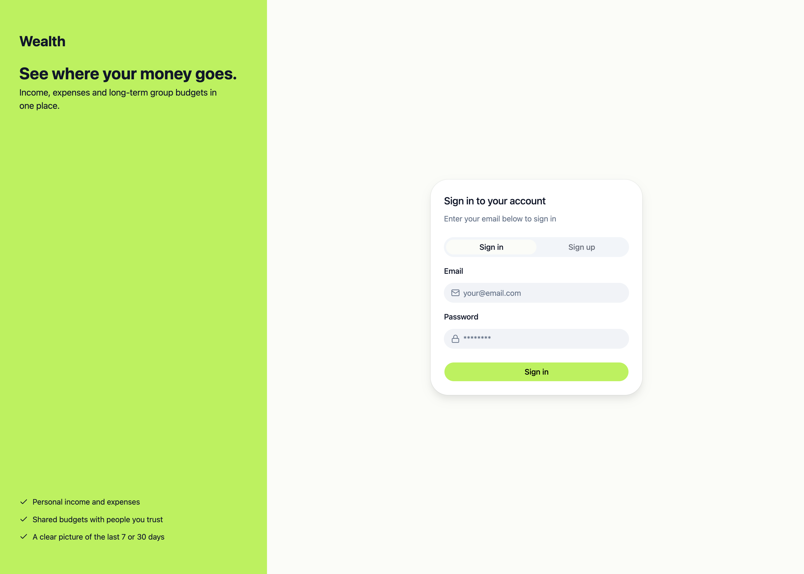
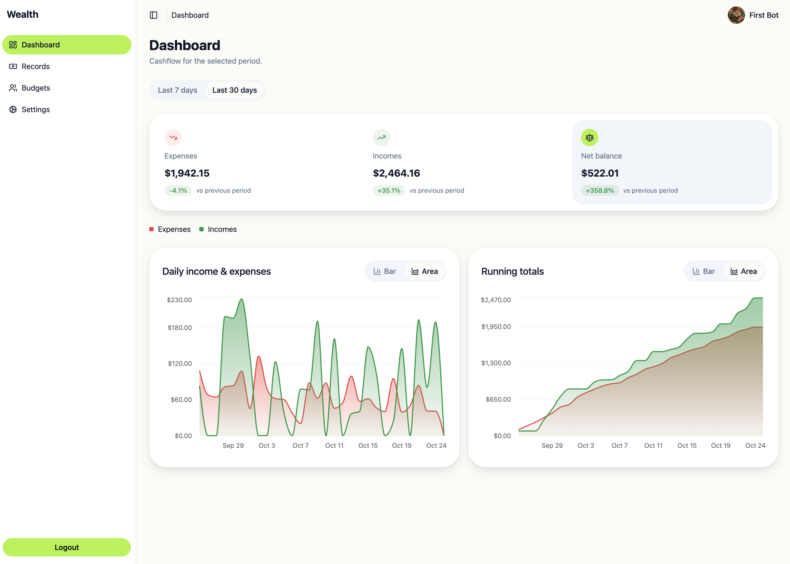
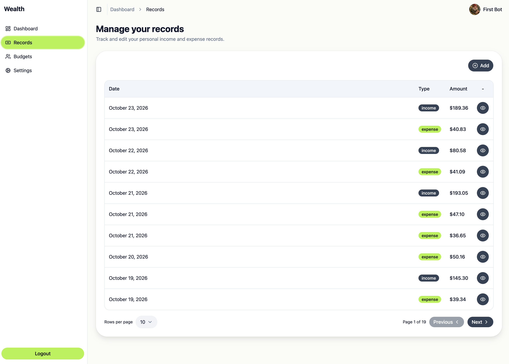
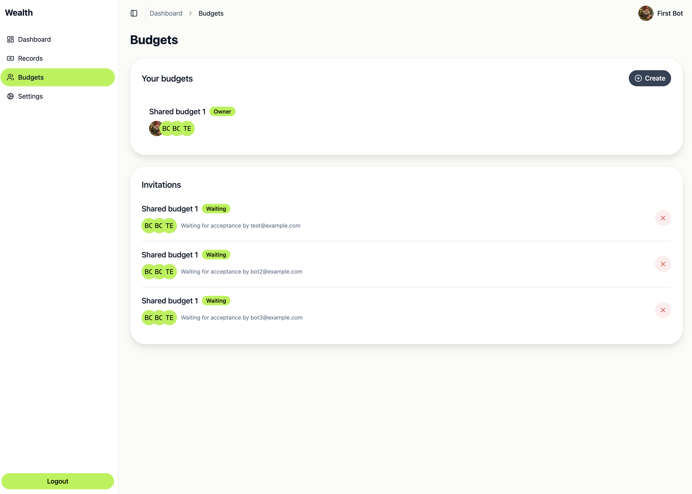

# Wealth

Wealth shows where money goes. It keeps personal income and expenses, shared group budgets, and a cashflow overview for a selected period in one place.

## Live app

The deployed app is at [https://wealth.pawel-gnat.workers.dev/](https://wealth.pawel-gnat.workers.dev/).

Demo account:

- Email: `test@example.com`
- Password: `Demo123!`

## Features

- **Account.** Sign up and sign in. Update your name, password, and avatar.
- **Dashboard.** Cashflow for the last 7 or 30 days: totals compared with the previous period, daily income and expenses, and running totals.
- **Records.** Personal income and expenses. Each record has a date and one or more line items (title, quantity, price). You can list, open, edit, and delete your own records.
- **Budgets.** Group budgets for shared income and expenses. Create a budget, invite people, and accept, reject, or cancel invitations. Members see the budget; only the person who added a record can edit or delete it. You can leave a budget, and deleting one removes its records.

## Screenshots

Sign in.



Dashboard for the selected period: totals against the previous period, daily income and expenses, and running totals.



Personal income and expense records.



Group budgets and invitations waiting for acceptance.



## Stack

pnpm and Turborepo monorepo on Node 22.

- **Web.** React, Vite, React Router, TanStack Query, Tailwind CSS, and shadcn/ui.
- **API.** NestJS and oRPC. Request and response schemas live in `@repo/api` (Zod). Persistence is Drizzle ORM on PostgreSQL.
- **Sessions.** Opaque tokens in httpOnly cookies. Redis publishes session-ended events over server-sent events.
- **Files.** S3-compatible storage for avatars. Locally that is MinIO.
- **Observability.** Better Stack for logs and errors.
- **Quality.** TypeScript, Biome, Vitest, and Playwright.

## Repository layout

- `apps/web` — the React app.
- `apps/backend` — the NestJS API, Drizzle schema, and local Docker Compose.
- `apps/e2e` — Playwright tests.
- `packages/api` (`@repo/api`) — Zod schemas, oRPC contracts, and shared types. The web app and the API both import this package.
- `packages/common` (`@repo/common`) — i18n strings, helpers, constants, and permissions shared by web and API.
- `packages/observability` (`@repo/observability`) — Better Stack logging and error reporting for the browser and for Node.
- `packages/biome-config`, `packages/typescript-config`, `packages/tsdown-config` — shared lint, TypeScript, and build config.

## Requirements

- Node.js `>= 22.18.0` (`.nvmrc` pins `22.18.0`)
- pnpm `10.33.0` (`packageManager` in the root `package.json`)
- Docker, for local PostgreSQL, Redis, and MinIO

## Local development

`pnpm install` reads a private package from GitHub Packages. Export `NODE_AUTH_TOKEN` (a token that can read `@pawel-gnat` packages) before installing:

```bash
pnpm install
```

Copy the env examples and leave the Better Stack variables empty if you do not need logs or error reporting locally:

```bash
cp apps/backend/.env.example apps/backend/.env
cp apps/web/.env.example apps/web/.env
```

Local MinIO (object storage in `docker-compose.dev.yaml`) requires a personal MinIO license file at `apps/backend/minio/minio.license` (gitignored). Without a valid license the container can start, but all S3 operations are denied.

Start the local services in the background, stop them without deleting data, or remove the containers and their volumes:

```bash
pnpm --filter backend docker:up
pnpm --filter backend docker:stop
pnpm --filter backend docker:down
```

That Compose file also starts Redis and MinIO. PostgreSQL is published on port `5433`. Apply migrations, then start the apps from the repo root:

```bash
pnpm --filter backend db:migrate
pnpm dev
```

The web app is at [http://localhost:3000](http://localhost:3000). The API is at [http://localhost:4000](http://localhost:4000).

## Useful commands

From the repo root:

- `pnpm dev` — web app, API, and shared packages in watch mode.
- `pnpm build` — production build of every package.
- `pnpm lint` — Biome check.
- `pnpm format` — Biome check with fixes applied.
- `pnpm check-types` — TypeScript across the workspace.
- `pnpm test` — unit tests.
- `pnpm test:e2e` — Playwright tests.

The pre-commit hook runs format, lint, and typecheck.

Database commands go through the backend package:

- `pnpm --filter backend db:generate` — write a migration after a Drizzle schema change. Do not edit SQL files under `apps/backend/drizzle/` by hand.
- `pnpm --filter backend db:migrate` — apply migrations.
- `pnpm --filter backend db:studio` — open Drizzle Studio.

`docker:up`, `docker:stop`, and `docker:down` are described in Local development.

## Architecture

The web app and the API share one contract in `@repo/api`. Zod schemas describe every input and output. Nest controllers implement that contract with oRPC. Outside production the same contract is published as Swagger at [http://localhost:4000/api-docs](http://localhost:4000/api-docs).

A signed-in device has two httpOnly cookies and one database row. The tokens are opaque. Redis publishes `session-ended` over server-sent events when that session ends. The session, logout, and refresh rules are in [docs/ADR.md](docs/ADR.md).

The web app keeps screen logic in the page that owns it. Higher layers may import lower ones.

- `src/app` — router and route constants.
- `src/pages/<slice>` — hooks, helpers, and UI for that screen.
- `src/shared/widgets` — reused presentational pieces.
- `src/shared` — UI kit, oRPC client, and helpers.

Domain types stay in `@repo/api`. Income and expense use the same records screens, distinguished by `kind`.

## Tests

`pnpm test` runs Vitest.

- **Web.** Testing Library and MSW. Default API responses live in `apps/web/src/test/mocks/handlers.ts`. Override that server in a test only when the case differs, for example an error or an empty list.
- **API.** A PostgreSQL Testcontainer starts for the suite and the Drizzle migrations are applied to it.
- **`@repo/common`.** Its own Vitest suite.

`pnpm test:e2e` runs Playwright in Chromium. It starts the API against a throwaway Postgres container and the Vite dev server. The specs cover income and expense flows. Outside CI, a server that is already listening on port 3000 or 4000 is reused. Install the browser once from `apps/e2e`:

```bash
pnpm exec playwright install chromium
```

Daily activity bots are a separate Playwright project. They sign in to a deployed app and add records. Copy `apps/e2e/.env.example` to `apps/e2e/.env` and set `FRONTEND_URL` and `BOT_PASSWORD`, then run:

```bash
pnpm --filter e2e test:bots
```

GitHub Actions runs five of these bots every day at 12:00 UTC against the deployed app. The workflow can also be started by hand.

## CI and release

A pull request to `main` runs format, lint, typecheck, tests, and a production build.

Publishing a GitHub release repeats those checks, then deploys the API to Fly.io (`wealth-api`, region `ams`) and the web app to Cloudflare Workers. The release commit has to be on `main`. After the API deploy, the workflow waits until `GET /ready` succeeds. If the web deploy then fails, it rolls the API back to the previous image.

## Observability

Both apps send logs and errors to Better Stack when the Better Stack variables are set. Production deploys require them. Locally they can stay empty, and reporting stays off.

The API exposes two checks:

- `GET /health` — the process is up. Fly uses this check.
- `GET /ready` — PostgreSQL and Redis both answer. The release workflow waits on this before deploying the web app.

## Conventions

File names are kebab-case. Zod schemas live only in `packages/api`: write bodies are `*PayloadSchema`, and read inputs (query or path) are `*ParamsSchema`. Install shadcn components from `apps/web` with the CLI, for example `pnpm dlx shadcn@latest add <component>`.

Further rules for this repo, including the frontend layers and how records and budgets behave, are in [AGENTS.md](AGENTS.md). Accepted decisions are in [docs/ADR.md](docs/ADR.md).
